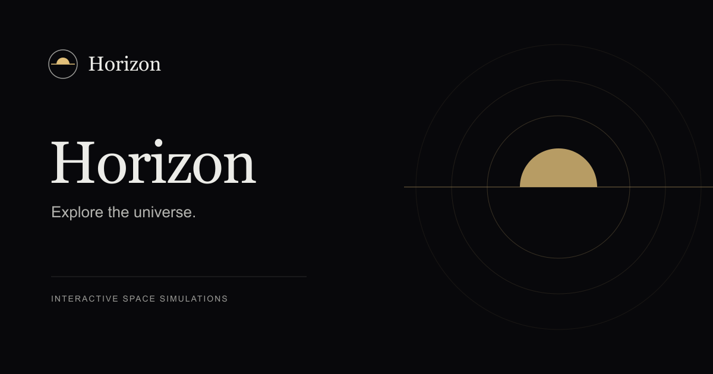
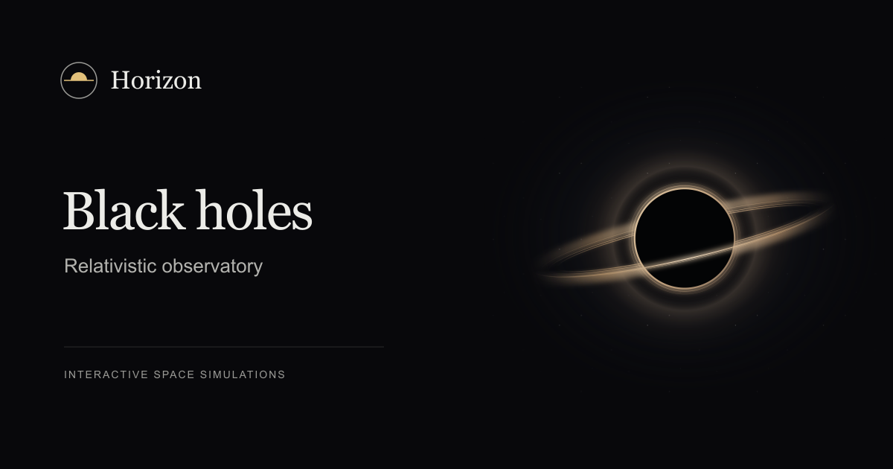
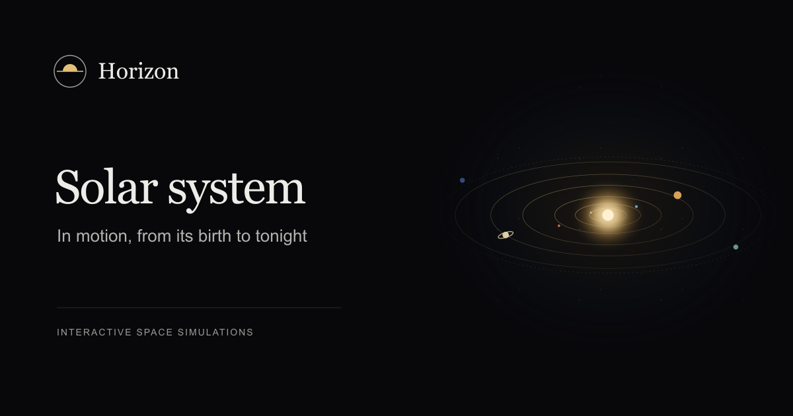
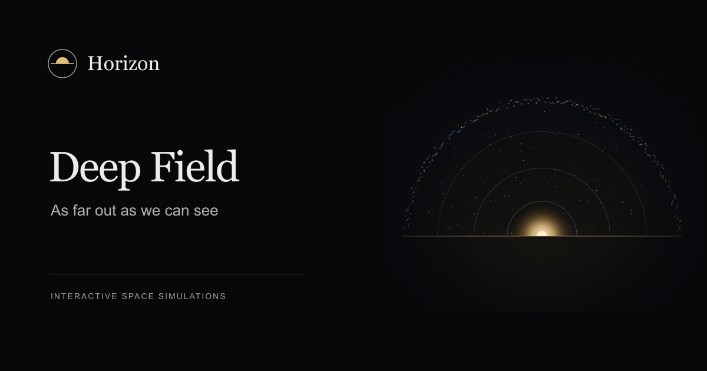
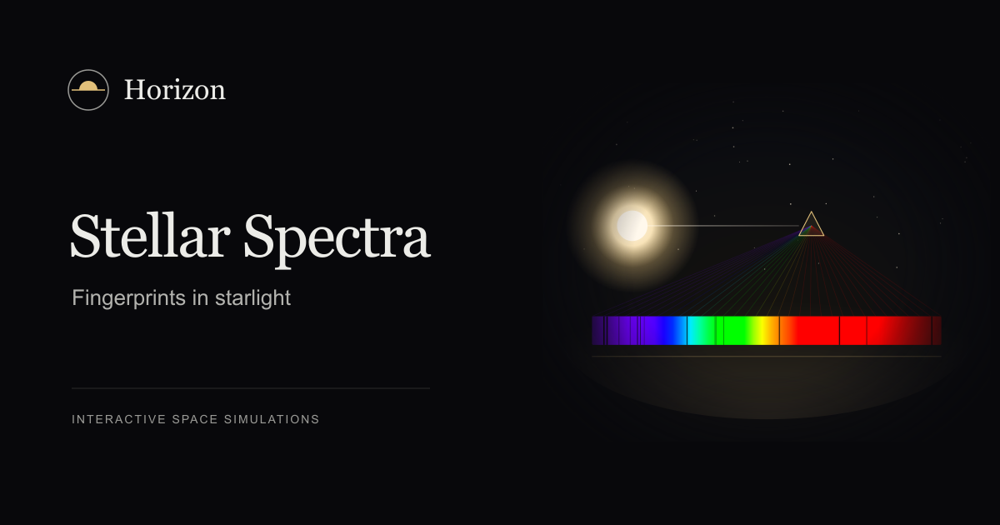

<div align="center">



# Horizon

**Interactive space simulations in the browser.**
Real data, honest models, every number sourced.

[](LICENSE)
[](package.json)
[](https://nextjs.org)
[](https://threejs.org)

</div>

## Simulations

<table>
  <tr>
    <td width="50%" valign="top">
      
      <h3>Black holes</h3>
      <p>Follow light around a spinning black hole: lensing, the accretion disk and the slow pace of time near the horizon.</p>
      <p>Ten scenes from Cygnus X-1 to TON 618 · guided tours · falling clocks · sky atlas</p>
      <p><a href="src/features/black-hole/README.md">Model and sources →</a></p>
    </td>
    <td width="50%" valign="top">
      
      <h3>Solar system</h3>
      <p>The planets where they are today and the clearing of the early solar system, out to the Oort cloud.</p>
      <p>Live JPL positions · 10-billion-year timeline · true-size close-ups</p>
      <p><a href="docs/science-sources.md">Sources →</a></p>
    </td>
  </tr>
  <tr>
    <td width="50%" valign="top">
      
      <h3>Deep field</h3>
      <p>Zoom from the planets through the nearest stars and the Milky Way to the microwave background. The farther you look, the older the light.</p>
      <p>Fourteen views · depth ladder · light-travel time and redshift</p>
      <p><a href="docs/science-sources.md">Sources →</a></p>
    </td>
    <td width="50%" valign="top">
      
      <h3>Stellar spectra</h3>
      <p>Split starlight into its colours and read the dark lines: which atoms, how hot, how fast.</p>
      <p>NIST atomic lines · Kirchhoff's bench · spectral sequence · mystery spectra</p>
      <p><a href="src/features/spectroscopy/lib/model">Model →</a></p>
    </td>
  </tr>
</table>

## Highlights

- **Grounded in data.** JPL orbital elements, IAU figures and spin, Gaia DR3 neighbours, measured planet maps. Every figure shown is checked in the [science source ledger](docs/science-sources.md).
- **Honest about models.** Approximations and teaching sketches are labelled as such, in the app and in the docs.
- **Explains itself.** Equations, technical notes and guided tours in every simulation.
- **For everyone.** English and Czech, dark and light, phone to desktop, reduced motion respected.
- **Static.** Prerendered at build time. No backend, database or API keys.

## Quick start

Requires Node.js 22.13+ or 24+.

```bash
npm ci
npm run dev
```

Open <http://localhost:3000>. Simulations live under `/lab`, for example `/lab/black-hole`,
`/lab/orrery`, `/lab/deep-field` and `/lab/spectroscopy`. URLs carry no language; a cookie picks it, English by default.

## Scripts

| Command                    | What it does                                       |
| -------------------------- | -------------------------------------------------- |
| `npm run dev`              | Development server                                 |
| `npm run build`            | Production build, every page prerendered           |
| `npm test`                 | Behaviour, physics, translation and contrast tests |
| `npm run test:bundles`     | Production bundle boundaries (after a build)       |
| `npm run typecheck`        | TypeScript, with Next.js route types               |
| `npm run lint` / `format`  | Oxlint / Oxfmt                                     |
| `npm run bench`            | Headless GPU benchmark ([guide](bench/README.md))  |
| `npm run docs:generate`    | Regenerate simulation READMEs from their specs     |
| `npm run shaders:generate` | Regenerate GLSL parameter headers                  |

## Project layout

```text
src/
  app/              Routes, layouts and metadata
  features/         Catalogue and one folder per simulation
  components/       Shell, shared simulation stage, status pages
  messages/         Shared English and Czech copy
packages/toolkit/   @horizon/toolkit: UI, math, science, camera, rendering, shaders
tests/              Node test runner suites
docs/               Architecture, UI, branding and science sources
bench/              Rendering benchmark
```

Each simulation owns its physics, state, copy and styles under `src/features/<slug>`. Shared code
lives in [`@horizon/toolkit`](packages/toolkit/README.md), which never imports the app.

## Built with

[Next.js](https://nextjs.org) App Router · [React 19](https://react.dev) with the React Compiler ·
[three.js](https://threejs.org) · [Tailwind CSS 4](https://tailwindcss.com) ·
[next-intl](https://next-intl.dev) · [Zustand](https://zustand.docs.pmnd.rs) ·
[Oxlint and Oxfmt](https://oxc.rs) · TypeScript

## Debugging

Every page exposes `Horizon.Debug` in the browser console, production included. Run
`Horizon.Debug.help()` for the full list.

| Command                                         | Effect                                          |
| ----------------------------------------------- | ----------------------------------------------- |
| `info()`                                        | GPU, WebGL, layout, viewport, theme and locale  |
| `webgl("unavailable" \| "software" \| "ready")` | Force the WebGL check in this tab               |
| `loseContext(ms = 1000)`                        | Lose the GPU context; `Infinity` never restores |
| `time("2026-12-21 16:00")` / `timeScale(600)`   | Sky and clocks at a moment / at a faster rate   |
| `crash()` / `crashRoot()` / `notFound()`        | Error, global error and 404 pages               |
| `reset()`                                       | Clear every override                            |

## Deployment

Import the repository into [Vercel](https://vercel.com) with the Next.js preset; no settings are
needed. Set `SITE_URL` to the production origin for share metadata. Locally, run `npm run build`
and `npm start`.

## Contributing

Issues and pull requests are welcome. Before opening one:

1. Read [the architecture guide](docs/architecture.md); new simulations follow it.
2. Keep `en.json` and `cs.json` in sync, and add any new physical figure to the
   [source ledger](docs/science-sources.md) with its reference.
3. Run `npm run typecheck`, `npm run lint`, `npm test`, `npm run build` and `npm run test:bundles`.

More: [all docs](docs/README.md) · [UI library](docs/ui-library.md) · [branding](docs/branding.md) ·
[black-hole physics audit](docs/black-hole-physics-audit.md) · [toolkit](packages/toolkit/README.md)

## License

[MIT](LICENSE) for Horizon's own code, docs and artwork. Planet imagery, music, scientific data
and dependencies keep their own licences; see [NOTICE](NOTICE.md).
